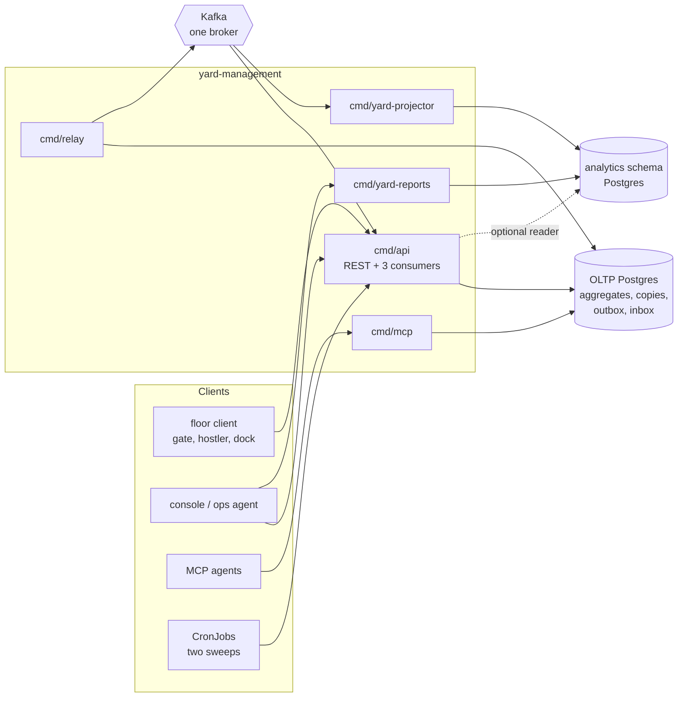

# Architecture

Go, hexagonal ([ADR 0002](/docs/adr/0002-aggregates-invariants-and-assumptions),
[ADR 0008](/docs/adr/0008-rest-adapter-and-api-process)), real Postgres and real
Kafka only: there is **no in-memory runtime**. The in-memory adapters exist only
as test doubles (`TestRuntimeBinaryHasNoInMemoryAdapters` forbids `cmd/**` from
importing them).

## Layout

```text
cmd/
  api/              REST API + the three Kafka consumers      :8080
  mcp/              MCP server, Streamable HTTP               :8090
  relay/            outbox relay (Postgres outbox -> Kafka)   :8081 (/healthz)
  yard-projector/   analytics writer (Kafka -> analytics schema) :8091 (/healthz /readyz)
  yard-reports/     read-only KPI reports                     :8092
internal/
  domain/           pure model, no I/O
    shared/           Location, Carrier, errors, events base
    yardvisit/        YardVisit aggregate (gate)
    trailer/          Trailer aggregate, door work, Occupancy service
    yardmove/         YardMove aggregate (lease, pull)
    yardcheck/        YardCheck aggregate (audit)
    yardpolicy/       YardPolicy aggregate (per-site rules)
  application/
    usecases/         one method of Yard per command, query and policy
    ports/            repositories, unit of work, locks, clock, outbox publisher
    views/            read models and filters
    outbox/           neutral outbox row and message types, event -> payload mapping
  analytics/report/   the analytics event folding and KPI definitions
  adapters/
    inbound/
      http/           chi router, handlers, Idempotency-Key, problem+json, readiness
      kafka/          dock-scheduling, facility, inbound-receiving and analytics consumers
      mcp/            tools, resources, prompt, idempotency, attribution
    outbound/
      postgres/       repositories, unit of work, locks, outbox, outbox relay, inbox, migrations
      kafka/          encoder, relay sink, writer, broker health check
      analyticsstore/ analytical schema projection and reader
      system/         clock and id generator
      memory/         test double only
    kafka/cloudevents/ the single CloudEvents envelope implementation
migrations/         OLTP schema (embedded)
analytics/migrations/ analytical schema (embedded)
```

Dependency rule (`TestHexagonalArchitecture`): `domain` imports nothing outward;
`application` imports `domain` and its own ports; adapters implement ports and
never import each other; the five `cmd/*` composition roots wire everything. The
MCP adapter has its own rule (`TestMCPAdapterDependencyRule`).

## Binaries

| Binary | Role | Port | Probes | Reads |
| --- | --- | --- | --- | --- |
| `cmd/api` | REST API for visits, trailers, moves, yard checks, policy, sweeps and the yard board; runs the **three Kafka consumers** in-process (a consumer that dies takes the process down); runs the OLTP migrations at boot; optionally serves `/reports/*` from the analytics database | `:8080` (`HTTP_ADDR`) | `/healthz`, `/readyz` | OLTP Postgres, Kafka, optional analytics reader |
| `cmd/mcp` | MCP server over the same use cases and database; enqueues outbox rows; runs the migrations at boot like the API | `:8090` (`MCP_ADDR`) | `/healthz`, `/readyz` | OLTP Postgres, Kafka (readiness only) |
| `cmd/relay` | drains the transactional `outbox` onto Kafka as CloudEvents; dead-letters poison rows; no migrations | `:8081` (`RELAY_HEALTH_ADDR`) | `/healthz` | OLTP Postgres, Kafka |
| `cmd/yard-projector` | only writer of the `analytics` schema: consumes `warehouse.yard-management.analytics`, folds each event, owns the analytical migrations | `:8091` (`ADMIN_ADDR`) | `/healthz`, `/readyz` | analytical Postgres, Kafka |
| `cmd/yard-reports` | read-only `/reports/*` over the `analytics` schema through a read-only pool | `:8092` (`HTTP_ADDR`) | `/healthz`, `/readyz` | analytical Postgres |

One image carries all five (`Dockerfile` loops over `cmd/*`; entrypoint `./api`);
the chart picks one per Deployment. The two sweeps are Kubernetes CronJobs that
call the API; no binary schedules anything itself. Configuration:
[Configuration](/docs/operations/configuration).

## Container diagram



Source: `cmd/api/main.go`, `cmd/mcp/main.go`, `cmd/relay/main.go`, `cmd/yard-projector/main.go`, `cmd/yard-reports/main.go`, `charts/yard-management/values.yaml`.

Kafka edges: the API consumes `warehouse.dock-scheduling.events`,
`warehouse.facility.events` and `warehouse.inbound-receiving.events`; the relay
produces `warehouse.yard-management.events`, `.analytics` and `.events.dlq`; the
projector consumes `.analytics`. Details: [Integration](/docs/ecosystem/integration).

## Data stores

| Store | Written by | Contents |
| --- | --- | --- |
| **OLTP Postgres** (`DATABASE_URL`) | api, mcp, relay (outbox deletes and attempts) | aggregate tables `yard_visits`, `trailers`, `yard_moves`, `yard_checks`, `yard_policies`; event-fed copies `zones`, `locations`, `appointments`, `door_closures`, `asns`, `receipts`; `processed_events` (inbox), `outbox`, `idempotency_keys`. Migrations `0001` and `0002` |
| **analytics schema** (`ANALYTICS_DATABASE_URL`; may be a separate database) | projector only | `processed_events`, `trailer_facts`, `door_dockings`, `door_work`, `hostler_moves`, `visit_facts`, `gate_exceptions`, `trailer_holds`, `yard_check_results`. Migrations `0001`, `0002` |
| **Kafka** | relay, consumers' dead-letter writers | the topics above |

The occupancy invariant (one trailer per place, one open move per trailer, one
claim per hostler, one open check per site, one open visit per plate) is enforced
twice: by partial unique indexes (`uq_trailers_one_per_location`,
`uq_yard_moves_one_open_per_trailer`, `uq_yard_moves_open_destination`,
`uq_yard_moves_one_claim_per_hostler`, `uq_yard_checks_one_open_per_site`,
`uq_yard_visits_one_open_per_plate`) and by per-location advisory locks inside
the unit of work. The full schema is on [Entity relationship](/docs/ddd/entity-relationship).

## Cross-cutting decisions

- **Transactional outbox.** A use case saves the aggregates, appends outbox rows
  and (for a Kafka-driven one) claims the CloudEvents id in `processed_events`, in
  one unit of work. The relay publishes; the use cases never touch Kafka.
- **Idempotency.** `Idempotency-Key` on every state-changing REST call and
  `idempotencyKey` on every MCP write, over the same `idempotency_keys` store.
- **No sibling calls.** Appointments, closures, locations, ASNs and receipts are
  local copies fed by events ([ADR 0003](/docs/adr/0003-consumed-contracts-and-local-copies),
  [ADR 0009](/docs/adr/0009-kafka-consumers)).
- **Read side apart.** Reports are served from a separate analytical schema by a
  read-only process ([ADR 0006](/docs/adr/0006-analytics-read-side),
  [ADR 0011](/docs/adr/0011-kpi-standard-reports)).
- **No auth.** By fleet decision.
- **Diagrams of the model** (class diagram, ER, sequences) are in the
  [DDD artifacts](/docs/ddd/ddd-artifacts).
